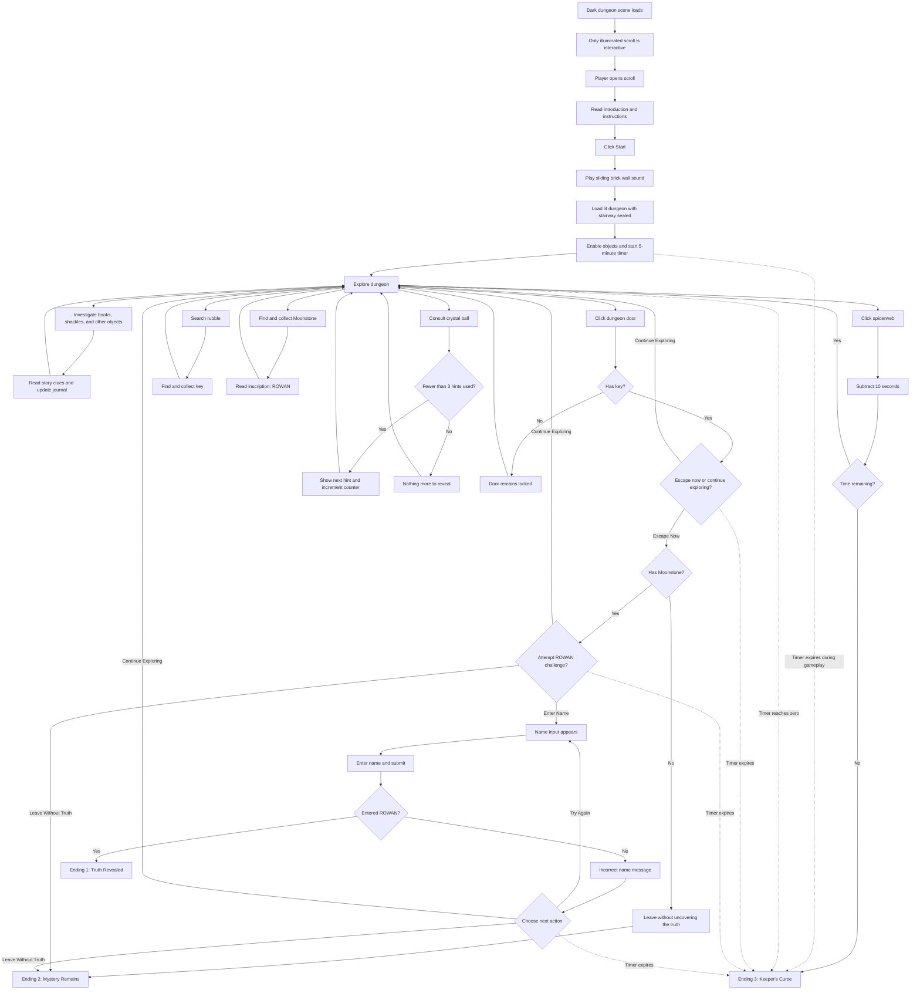

# escaping-the-blood-moon
WEB115 Final Project — Escaping the Blood Moon: The Keeper's Curse

# Game Description and Game Play
The scroll reads: "The Moonstone lies hidden beneath this very castle... the Keeper has searched for it for centuries. Beware of him, the Blood Moon has twisted his mind! Long ago, the Professor sought to stop the Keeper and conceal the Moonstone from those who would misuse its power. To protect the artifact, the castle was sealed and its secrets buried beneath stone and shadow. If the Blood Moon rises before the Moonstone can be secured, the curse will claim yet another victim. Tread carefully..."

Overview - The blood moon is rising. As Lancelot travels through the strange forest, curiosity leads him into a dilapidated castle and into its dark dungeon. He reads a scroll tacked onto the wall. Alas, the trap is sprung -- the opening closes, a timer starts, and he must uncover clues from the various items strewn about before the timer ends and he perishes -- or worse!

Interactivity - 

Endings -

# Group Member Roles
All - Contribute to the pseudo code and Mermaid diagram.
    - Participate in the overall game play development.

Kris - Creates visual assets for the game. 
     - Initializes the html file.

Christie - Develops JavaScript game mechanics and interactions.
         - Creates and integrates the Mermaid flowchart.
         - Coordinates GitHub integration and rubric verification.

# Story Flowchart / Mermaid Diagram

